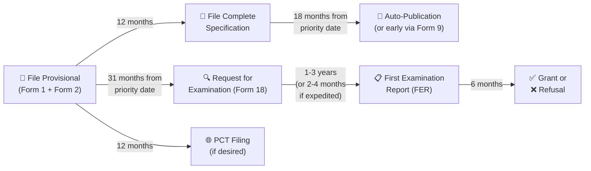

# Filing Checklist — TimetableGenie: NEP-2020 Timetable Generator

**Indian Patent Application under the Patents Act, 1970 & Patents Rules, 2003**
**Inventors:** Mohammad Hamid Khan, Sachin Yadav
**Date prepared:** 2026-11-17

---

## 0. CRITICAL PRE-FILING ISSUE: Prior Public Disclosure

> [!CAUTION]
> **India follows an absolute novelty standard.** Any public disclosure before filing can destroy patentability. Assess the following BEFORE filing:

| Disclosure Event | Date | Risk Level | Action Required |
|-----------------|------|------------|-----------------|
| SIH presentation/demo | [TO CONFIRM] | 🔴 **HIGH** | If the invention was publicly presented at SIH (live demo, video, slides revealing the technical method), this may constitute prior art. India's Section 31 grace period is **very narrow** — it covers only government-notified exhibitions (not hackathons) and learned-society papers. SIH likely does **not** qualify. |
| GitHub repository (if public) | [TO CONFIRM] | 🔴 **HIGH** | A public GitHub repo with the source code is a publication. If it was public before the filing date, the entire codebase is prior art. **Make the repo private immediately if not already.** |
| Academic papers / posters | [TO CONFIRM] | 🟡 MEDIUM | A paper before a "learned society" may qualify under Section 31(d) if Form 31 is filed within 12 months. |
| College project presentations | [TO CONFIRM] | 🟡 MEDIUM | Internal presentations to limited audiences with no public recording may be defensible. Document the audience scope. |

### Recommended Strategy
1. **If NO public disclosure has occurred:** File as soon as possible (provisional or complete).
2. **If public disclosure occurred < 12 months ago:** Immediately file a provisional specification to lock in the earliest possible priority date. Assess whether Section 31 protection applies. Consult a patent agent.
3. **If public disclosure occurred > 12 months ago:** Novelty may be destroyed under Indian law. Consider: (a) whether the disclosed version differs materially from the current invention, (b) PCT filing in jurisdictions with broader grace periods (US: 12 months general grace period under 35 U.S.C. § 102(b)(1)).

---

## 1. Filing Strategy: Provisional vs. Complete Specification

| Option | Pros | Cons | Recommendation |
|--------|------|------|----------------|
| **Provisional Specification (Form 2 — Provisional)** | Secures priority date immediately. Cheaper. 12 months to finalize the complete specification. Useful if the invention is still evolving. | Does not start examination. Must file complete within 12 months or application lapses. | ✅ **Recommended if you want to file quickly** to lock in the date before any further public disclosure. |
| **Complete Specification (Form 2 — Complete)** | Full examination can begin once RFE is filed. Stronger filing. | Requires fully drafted claims, description, and drawings at filing time. | Recommended if the specification is fully ready and no urgency for priority date. |

> [!TIP]
> **Recommended approach:** File a **provisional specification** NOW to secure the priority date, then file the complete specification within 12 months with refined claims and drawings.

---

## 2. Required Forms & Documents

### At Filing

| Form | Purpose | Details | Fee (Natural Person / Startup, e-filing) |
|------|---------|---------|----------------------------------------|
| **Form 1** | Application for Grant of Patent | Applicant details, inventor details, title. Both inventors listed. If applicants are the inventors themselves, state so. | Included in combined fee |
| **Form 2** | Provisional or Complete Specification | The patent specification document (title, description, claims, abstract, drawings). | **₹1,600** combined (Form 1 + Form 2) for ≤30 pages, ≤10 claims |
| **Form 3** | Statement & Undertaking under Section 8 | Declare any corresponding patent applications filed in other countries (e.g., PCT, US). If none, state "No corresponding applications filed." Must be updated within 6 months of any foreign filing. | No separate fee |
| **Form 5** | Declaration as to Inventorship | Required when applicant and inventor are the same (which is likely your case). Lists each inventor and their contribution. | No separate fee |
| **Form 26** | Authorization of Patent Agent | Required **only if** you appoint a registered patent agent to file/prosecute on your behalf. | No separate fee (agent's professional fees are separate) |
| **Form 28** | Statement regarding startup / small entity status | Required if claiming reduced fees as a **DPIIT-recognized startup**. Not needed if filing as natural persons (individuals). | No separate fee |

### Additional Fee Calculations

| Item | Natural Person / Startup Rate |
|------|------------------------------|
| Base filing (Form 1 + Form 2, ≤30 pages, ≤10 claims) | ₹1,600 |
| Each additional page beyond 30 | ₹160/page |
| Each additional claim beyond 10 | ₹320/claim |
| Paper filing surcharge (if not e-filing) | +10% |

> [!IMPORTANT]
> **E-filing is strongly recommended** (saves 10% and is faster). Use the IP India e-filing portal: https://ipronline.ipindia.gov.in

### Post-Filing Forms

| Form | When | Fee (Natural Person / Startup) |
|------|------|-------------------------------|
| **Form 9** — Request for Early Publication | Optional; to publish before the default 18-month window. Published within ~1 month. | ₹2,500 |
| **Form 18** — Request for Examination (RFE) | Must be filed within **31 months** of priority date. Examination will not begin without this. | ₹4,000 |
| **Form 18A** — Request for Expedited Examination | Available for startups, female inventors, government institutions. FER issued within 2–4 months instead of 1–3 years. | ₹8,000 |

---

## 3. Applicant & Inventor Details

| Field | Inventor 1 | Inventor 2 |
|-------|-----------|-----------|
| Full Name | Mohammad Hamid Khan | Sachin Yadav |
| Nationality | [TO CONFIRM — Indian?] | [TO CONFIRM — Indian?] |
| Residence Address | [TO CONFIRM] | [TO CONFIRM] |
| Email | [TO CONFIRM] | [TO CONFIRM] |

### Applicant vs. Inventor
- **If both inventors are filing as individuals (natural persons):** They are both applicants AND inventors. Use the **natural person** fee tier (₹1,600). No Form 28 needed.
- **If filing through a university or institution:** The institution is the applicant; inventors are listed in Form 5. Check if the institution qualifies as a startup or educational institution for reduced fees.
- **If filing through a startup entity:** Need DPIIT recognition certificate + Form 28.

> [!NOTE]
> **Joint filing rule:** If even one applicant is a large entity, the entire application is billed at the large entity rate. All applicants must qualify for the concession tier.

---

## 4. Fee Concessions Available

| Category | Discount | How to Qualify |
|----------|----------|---------------|
| **Natural Person (Individual)** | 80% off large-entity fees | File as individual inventors. No special documentation needed beyond ID proof. |
| **Startup** | 80% off | Must have valid DPIIT recognition. File Form 28 with proof. |
| **Small Entity (MSME)** | 80% off | Udyam Registration certificate required. File Form 28. |
| **Educational Institution** | 80% off | Proof of institutional status. File Form 28. |

> [!TIP]
> **For Mohammad Hamid Khan & Sachin Yadav:** Filing as **natural persons** is the simplest and cheapest route — ₹1,600 total for initial filing (e-filed). No Form 28 needed.

---

## 5. Section 3(k) Compliance Strategy

> [!WARNING]
> **Section 3(k) of the Indian Patents Act** excludes "computer programmes per se" and mathematical methods. This is the biggest legal risk for a software-based timetabling patent in India.

### Drafting Strategy (applied in PATENT_SPEC.md)
1. **Frame as a "computer-implemented method" with technical effect**, not as a "computer program" or "algorithm."
2. **Emphasize technical effects:**
   - Reduction in computational resource usage via constraint pre-pruning
   - Guaranteed conflict-free output (technical certainty, not just best-effort)
   - Machine-checkable verification certificate (a concrete technical artifact)
   - Specific data structures for encoding NEP-2020 course hierarchies
3. **Claim system architecture**, not just logic:
   - Claim the system (processor + memory + modules)
   - Claim the method with specific data-transformation steps
   - Claim the computer-readable medium storing the program
4. **Avoid:**
   - Claiming "a method of scheduling" in abstract terms
   - Claiming a mathematical formula or algorithm by name alone
   - Language that reads like a business method

### Key Legal Precedent
- **Ferid Allani v. Union of India (2019):** Delhi HC held that computer-implemented inventions with a "technical effect" or "technical contribution" are patentable, even if they use computer programs. Section 3(k) bars only "per se" (standalone) computer programs.
- **CRI Guidelines (IPO):** Examiners apply a "technical effect test" — the invention must solve a technical problem or produce a tangible technical output beyond ordinary data processing.

---

## 6. PCT Adaptability

If you later wish to file internationally via the **Patent Cooperation Treaty (PCT)**:

| Item | Detail |
|------|--------|
| **Priority claim** | File PCT within 12 months of the Indian filing date to claim priority. |
| **Filing route** | File PCT application via Indian Patent Office (as Receiving Office) or directly at WIPO (via ePCT). |
| **Form 3 obligation** | You must update Form 3 with the IPO within 6 months of filing the PCT application. |
| **National phase** | Enter national phase in target countries within 30/31 months of priority date. |
| **US considerations** | US has a broader grace period (12 months from public disclosure). Prior SIH presentations may be less damaging in US prosecution. |
| **EU/EPO considerations** | Absolute novelty, similar to India. Same disclosure risks apply. |
| **Cost** | PCT filing fee: ~₹12,000 (natural person, with e-filing reduction); search fee (ISA/IN): ~₹10,000. |

---

## 7. Timeline & Key Deadlines

---

## 8. Pre-Filing Action Items

- [ ] **URGENT:** Confirm all prior public disclosures (SIH demo date, GitHub visibility, any papers/posters)
- [ ] **URGENT:** Make GitHub repository **private** if currently public
- [ ] Confirm nationality and residence addresses for both inventors
- [ ] Decide: filing as natural persons or through institution/startup?
- [ ] Decide: provisional or complete specification first?
- [ ] Decide: self-filing or appointing a patent agent (Form 26)?
- [ ] If startup: obtain DPIIT recognition certificate
- [ ] Register on IP India e-filing portal: https://ipronline.ipindia.gov.in
- [ ] Prepare digital signatures (DSC) for e-filing OR use OTP-based signing
- [ ] Review PATENT_SPEC.md and finalize claims after code review (Step 1)
- [ ] Budget: minimum ₹1,600 (filing) + ₹4,000 (RFE) = **₹5,600** total government fees as natural persons

---

## 9. Document Checklist at Filing

| Document | Status |
|----------|--------|
| Form 1 (Application) | ⬜ To prepare |
| Form 2 (Specification — Provisional or Complete) | ⬜ Draft in progress (PATENT_SPEC.md) |
| Form 3 (Statement & Undertaking) | ⬜ To prepare |
| Form 5 (Declaration of Inventorship) | ⬜ To prepare |
| Form 26 (Agent Authorization) — if using agent | ⬜ To confirm |
| Form 28 (Startup/Small Entity Declaration) — if applicable | ⬜ To confirm |
| Drawings (FIG. 1 through FIG. 5+) | ⬜ To create (Step 4) |
| Priority document (if claiming convention priority) | ⬜ N/A for first filing |
| ID proof of inventors | ⬜ To collect |
| Address proof of inventors | ⬜ To collect |

---

> [!IMPORTANT]
> **Next steps after code is in place:**
> 1. Complete Step 1 (PATENT_NOTES.md — understand the code)
> 2. Refine PRIOR_ART.md with actual algorithm details
> 3. Draft PATENT_SPEC.md with concrete claims tied to code
> 4. Create drawings (Step 4)
> 5. Finalize this checklist with inventor details and disclosure assessment
